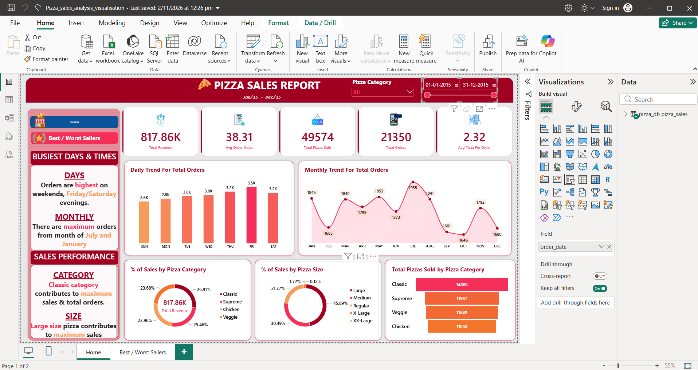
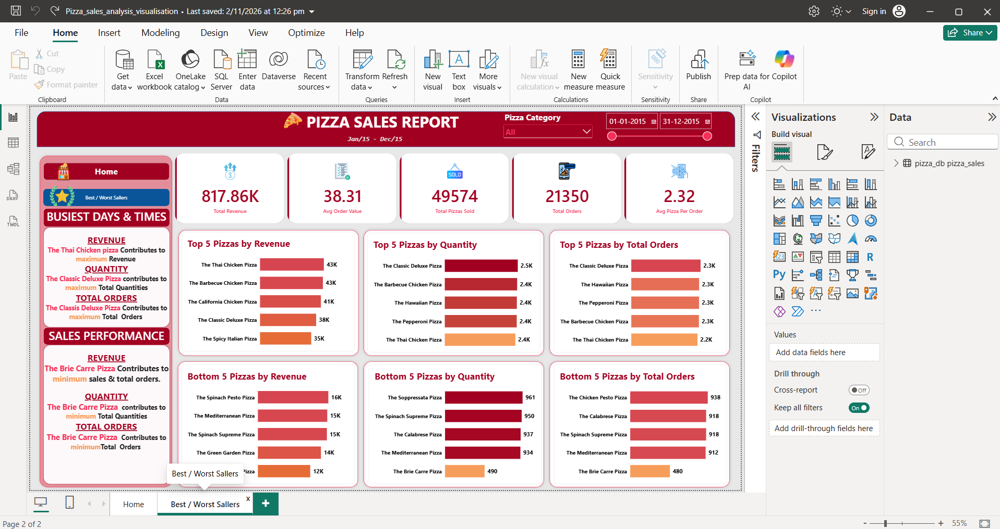
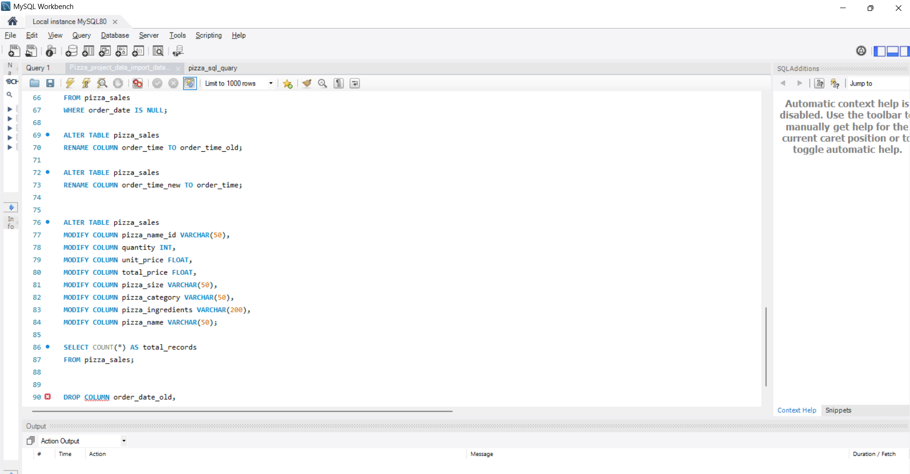

# 🍕 Pizza Sales Analysis – MySQL & Power BI

## 📌 Project Overview

This project focuses on analyzing pizza sales data using **MySQL and Power BI** to understand business performance, customer ordering patterns, and product sales.

SQL queries are used to calculate important business metrics and answer sales-related questions. Power BI is used to create an interactive dashboard that presents the results through KPIs, charts, and filters.

## 🎯 Project Objectives

- Analyze overall pizza sales performance.
- Identify the busiest days and months for orders.
- Understand sales distribution across pizza categories and sizes.
- Identify the top and bottom-selling pizzas.
- Track important business KPIs.
- Present sales insights through an interactive Power BI dashboard.

## 🛠️ Tools & Technologies

- **MySQL** – Data analysis using SQL queries.
- **Power BI** – Interactive dashboard and data visualization.
- **Power Query** – Data transformation and preparation.
- **Excel / CSV** – Dataset handling.

## 📂 Project Workflow

1. **Data Collection:** Used the pizza sales dataset.
2. **SQL Analysis:** Imported the data into MySQL and wrote queries to calculate business metrics.
3. **Data Transformation:** Prepared and transformed the data using Power Query.
4. **Dashboard Development:** Created an interactive Power BI dashboard.
5. **Insights:** Analyzed sales trends, pizza categories, sizes, and product performance.

## 📊 Key Performance Indicators (KPIs)

- **Total Revenue:** Total sales revenue generated.
- **Average Order Value:** Average revenue generated per order.
- **Total Pizzas Sold:** Total quantity of pizzas sold.
- **Total Orders:** Total number of customer orders.
- **Average Pizzas Per Order:** Average number of pizzas purchased per order.

## 🔍 Business Questions Answered Using SQL

1. What is the total revenue generated from pizza sales?
2. What is the average order value?
3. How many pizzas were sold in total?
4. How many orders were placed?
5. What is the average number of pizzas per order?
6. Which days of the week have the highest number of orders?
7. Which months have the highest number of orders?
8. What is the revenue contribution of each pizza category?
9. What percentage of total revenue comes from each pizza category?
10. Which pizza sizes contribute the most to sales?
11. What is the quantity sold for each pizza category?
12. What are the top 5 and bottom 5 pizzas based on revenue, quantity, and total orders?

## 📈 Power BI Dashboard

### 1. Dashboard Overview



### 2. Category Analysis



## 💻 SQL Queries

The following screenshot shows the SQL queries used to analyze pizza sales data and calculate important business metrics.



## 📁 Repository Structure

```text
Pizza-Sales-Analysis/
│
├── Dataset/
│   └── pizza_sales.csv
│
├── SQL/
│   ├── pizza_sales_analysis.sql
│   └── SQL_Analysis_Report.docx
│
├── Pizza_sales_analysis_visualisation.pbix
│
├── Screenshots/
│   ├── dashboard_overview.png
│   ├── dashboard_category_analysis.png
│   └── sql_queries.png
│
└── README.md
```

## 📚 Key Learnings

- Writing SQL queries for business data analysis.
- Using aggregate functions, grouping, sorting, and filtering in MySQL.
- Calculating business KPIs.
- Transforming data using Power Query.
- Creating interactive dashboards in Power BI.
- Understanding sales trends and product performance.
- Presenting data-driven business insights.

## 👨‍💻 Author

**Yash Desai**

- GitHub: [Yash-Desai-2005](https://github.com/Yash-Desai-2005)

---

*This project was created as part of my Data Analytics learning journey to develop practical skills in SQL, data analysis, and Power BI visualization.*
